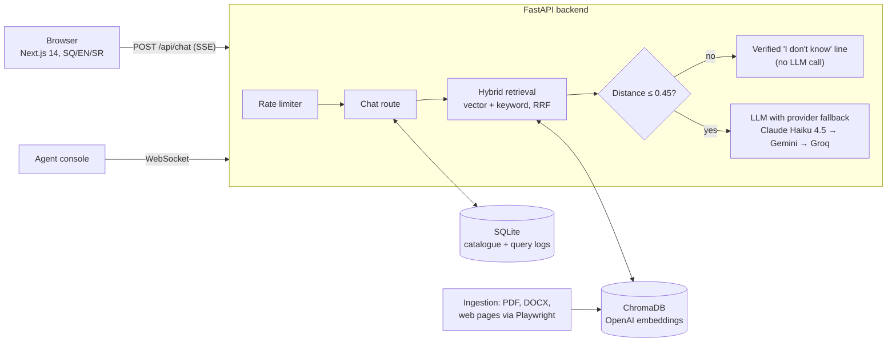

# ZANA

**An AI assistant that answers questions about Kosovo's public services in Albanian, English and Serbian, and cites its sources.**

Ask *"Sa kushton pasaporta?"* and ZANA finds the official procedure, streams a short answer with numbered citations, and shows the documents, fee, processing time and office. When the sources don't cover a question, it says so instead of guessing.

[](https://github.com/rinorze/Zana-AI/actions/workflows/ci.yml)

**Live demo:** https://zana-ai-platform.vercel.app. The backend runs on a free tier, so the first question after a quiet period can take about 30 seconds while it wakes up.

<!-- Demo GIF goes here once the hosted demo is live. -->

> Independent project. Not affiliated with, or endorsed by, the Government of Kosovo or eKosova. Service information comes from public eKosova pages. Always check the official source before acting on it.

## What it does

| Persona | What they get |
|---|---|
| **Citizen** | Streaming chat with citations; voice input (Whisper) and read-aloud; a simple-language and high-contrast mode; service pages with a step-by-step walker; side-by-side service comparison |
| **Call-centre agent** | A co-pilot over WebSocket that suggests answers as the agent types, reusable reply templates, and an after-call summary |
| **Admin** | Edit the service catalogue in three languages, upload PDF/DOCX files or queue URLs for ingestion, re-index, see analytics, and try queries in a RAG playground |

The demo is seeded with 20 services across 11 categories (civil documents, business, tax, transport, health and more).

## Architecture



### How one question is answered

1. **Rate limit.** Per-IP limits and a global daily cap protect the API budget (`app/middleware/rate_limit.py`).
2. **Language.** The language is taken from the request or detected from the text (`app/llm/language.py`).
3. **Retrieve.** The query is embedded with `text-embedding-3-small`. ChromaDB returns 15 candidate chunks filtered to that language. A keyword score ranks the same candidates a second way, and the two rankings are merged with Reciprocal Rank Fusion (k = 60) (`app/rag/retriever.py`).
4. **Ground or refuse.** Chunks with a cosine distance above 0.45 are dropped. If nothing is left, ZANA streams a fixed "I don't have reliable information" line with the eKosova contact, and the LLM is never called.
5. **Answer.** The top chunks go into the prompt as numbered sources. The answer streams over Server-Sent Events, and only the citations the model actually used are kept at the end.
6. **Log.** The question, whether it was grounded, and the answer are stored for the admin analytics.

## Key engineering decisions

- **Refuse rather than guess.** Fees and deadlines that are wrong do real harm. The distance threshold is a hard gate in code, not a prompt instruction, so an off-topic question never reaches the model.
- **Hybrid retrieval, kept simple.** A short query that names a service (for example "regjistrim biznesi") should put that service first. Embeddings alone don't guarantee that. A light keyword score, plus a boost when the query names the service, is fused with the vector ranking using RRF. This is not full BM25: the keyword score only re-ranks the vector candidates.
- **700-word chunks with 100 words of overlap.** That's large enough to keep a whole step list or fee table together, while the overlap stops a sentence that crosses a boundary from being lost (`app/rag/chunker.py`).
- **Server-Sent Events, not WebSockets, for chat.** Chat is one-way streaming, so SSE is plain HTTP, simpler to proxy and easier to debug. The agent co-pilot uses a WebSocket because the client keeps sending keystrokes and the server cancels stale requests.
- **LLM provider fallback.** Claude Haiku 4.5 by default. If a provider fails before it sends the first token, the same request goes to the next configured provider (Gemini, then Groq). Only providers with an API key set are tried. Once tokens have streamed, the request isn't switched mid-answer (`app/llm/claude.py`).
- **Measured, not assumed.** `scripts/eval_rag.py` scores retrieval on a fixed question set (see Evaluation).
- **Safe to expose publicly.** Rate limits and a daily cap on paid endpoints; production refuses to start with default secrets; admin and agent routes need a JWT.

## Evaluation

`backend/scripts/eval_rag.py` runs the chat's own retrieval over 30 hand-written questions (`backend/eval/questions.jsonl`): 26 about the seeded services in Albanian, English and Serbian, and 4 off-topic questions that should be refused. It reports hit@1, hit@5, MRR, how often in-scope questions pass the grounding threshold, and how often off-topic questions are correctly refused.

```bash
cd backend
python -m scripts.seed && python -m scripts.index_catalogue   # needs OPENAI_API_KEY
python -m scripts.eval_rag                                    # writes eval/report.md
```

Latest results: see [`backend/eval/report.md`](backend/eval/report.md).

## Run it locally

Requires Python 3.11 (ChromaDB 0.5 has no prebuilt `chroma-hnswlib` wheel for 3.12 on Windows) and Node 20.

```bash
# Backend
cd backend
python3.11 -m venv .venv && source .venv/bin/activate      # Windows: .venv\Scripts\activate
pip install -r requirements.txt
cp .env.example .env                                       # add ANTHROPIC_API_KEY and OPENAI_API_KEY
python -m scripts.seed
python -m scripts.index_catalogue
uvicorn app.main:app --reload

# Frontend (new terminal)
cd frontend
cp .env.example .env.local
npm install
npm run dev
```

Citizen: http://localhost:3000 · Agent: http://localhost:3000/agent/login · Admin: http://localhost:3000/admin/login (credentials come from `backend/.env`).

Or with Docker: `docker compose up --build`, then run the seed and index scripts inside the backend container.

## Deploying the demo

- **Backend:** `backend/Dockerfile.deploy` (Hugging Face Spaces on port 7860, or Render via `$PORT`). On every start it seeds the catalogue and rebuilds the index, so it needs no persistent disk. Set `ANTHROPIC_API_KEY`, `OPENAI_API_KEY`, `JWT_SECRET`, `ADMIN_PASSWORD`, `AGENT_PASSWORD` and `FRONTEND_URL`.
- **Frontend:** Vercel, with `NEXT_PUBLIC_API_BASE` set to the backend URL. It's read at build time, so redeploy after changing it.
- **Check it:** `python -m scripts.smoke_test https://<backend-url>` asks one Albanian and one English question and fails if either answer has no citations.

Rate-limit counters live in memory. That suits a single-process demo; several instances would need a shared store such as Redis.

## Tests and CI

```bash
cd backend && pytest -q                         # LLM and embedding calls are stubbed
cd frontend && npx tsc --noEmit && npm run lint && npm run build
```

GitHub Actions runs the backend tests, the frontend typecheck, lint and build, and a job that builds the demo image and checks that it boots.

## Stack

FastAPI · SQLAlchemy 2 · ChromaDB 0.5 · OpenAI embeddings and Whisper · Anthropic (Claude Haiku 4.5) with Gemini/Groq fallback · Playwright, pypdf, python-docx for ingestion · Next.js 14 (App Router) · Tailwind · Radix UI · Zustand · pytest · Docker · GitHub Actions.

More detail: [`IMPLEMENTATION_PLAN.md`](IMPLEMENTATION_PLAN.md) (original build spec), [`PROGRESS.md`](PROGRESS.md), [`DEMO_SCRIPT.md`](DEMO_SCRIPT.md).
